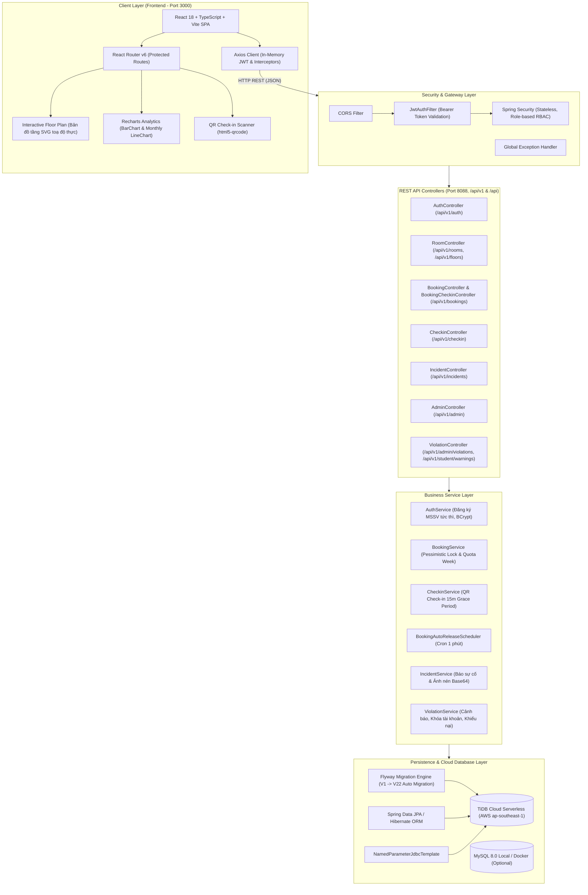

# Smart Campus Facility & Study Room Reservation Platform

Nền tảng Quản lý & Đặt phòng tự học, Cơ sở vật chất trường đại học thông minh (**Thư Viện Thông Minh**). Dự án được thiết kế và xây dựng theo kiến trúc Client-Server chuẩn mực, bám sát tài liệu đặc tả yêu cầu phần mềm tiêu chuẩn **SRS ISO/IEC/IEEE 29148**.

---

## 📑 Mục lục
1. [Tổng quan kiến trúc hệ thống](#-tổng-quan-kiến-trúc-hệ-thống)
2. [Ngăn xếp công nghệ (Tech Stack)](#-ngăn-xếp-công-nghệ-tech-stack)
3. [Cấu trúc thư mục dự án](#-cấu-trúc-thư-mục-dự-án)
4. [Yêu cầu môi trường (Prerequisites)](#-yêu-cầu-môi-trường-prerequisites)
5. [Hướng dẫn khởi chạy hệ thống (Quick Start)](#-hướng-dẫn-khởi-chạy-hệ-thống-quick-start)
   - [Phương án 1: Sử dụng TiDB Cloud (Mặc định - Khuyên dùng)](#phương-án-1-kết-nối-tidb-cloud-aws-mặc-định---khuyên-dùng)
   - [Phương án 2: Sử dụng MySQL Local / Docker](#phương-án-2-sử-dụng-mysql-local--docker-offline)
6. [Các cơ chế nghiệp vụ cốt lõi](#-các-cơ-chế-nghiệp-vụ-cốt-lõi)
7. [Tài khoản đăng nhập kiểm thử (Seed Accounts)](#-tài-khoản-đăng-nhập-kiểm-thử-seed-accounts)
8. [Tài liệu API & Swagger UI](#-tài-liệu-api--swagger-ui)
9. [Chạy kiểm thử tự động (Testing)](#-chạy-kiểm-thử-tự-động-testing)
10. [Quy ước nhánh Git & Tài liệu đặc tả](#-quy-ước-nhánh-git--tài-liệu-đặc-tả)

---

## 🏛 Tổng quan kiến trúc hệ thống

Hệ thống hoạt động theo mô hình **Single Page Application (SPA) kết hợp RESTful API**, kết nối trực tiếp 100% dữ liệu thực tế giữa Frontend React và Backend Spring Boot:



---

## 🛠 Ngăn xếp công nghệ (Tech Stack)

### 1. Backend (Spring Boot 3)
* **Ngôn ngữ:** Java 17 / 21 LTS
* **Framework:** Spring Boot 3.3.4 (Spring Web, Spring Security 6, Spring Data JPA, Spring Validation)
* **Cơ sở dữ liệu:**
  * **TiDB Cloud Serverless** (Phân tán tương thích MySQL 8.0, triển khai trên AWS Singapore `ap-southeast-1`).
  * **MySQL 8.0** (Hỗ trợ chạy Offline qua Docker Compose hoặc MySQL Server cục bộ).
* **Quản lý Migration:** **Flyway 10.x** (tự động áp dụng từ `V1` đến `V22`).
* **Bảo mật:** Stateless JWT (HMAC-SHA256, Access Token 15 phút, Refresh Token 7 ngày trong DB), mã hóa mật khẩu **BCrypt** (cost=10).
* **Tài liệu API:** **Springdoc OpenAPI 3.0 / Swagger UI**.
* **Công cụ build:** Maven Wrapper (`./mvnw` / `.\mvnw.cmd`).

### 2. Frontend (React + Vite)
* **Framework:** React 18 (TypeScript), Vite 5 (Hot Module Replacement + API proxy `/api` → `http://localhost:8088`).
* **Giao diện & UI:** Tailwind CSS, Lucide React Icons, hiệu ứng chuyển động mượt mà (hỗ trợ `prefers-reduced-motion`), bộ nhận diện thương hiệu (`public/logo.png` & `public/favicon.png`), điều hướng responsive trên `Navbar`.
* **Biểu đồ & Thống kê:** **Recharts** (`BarChart` tỷ lệ lấp đầy theo tầng, `BarChart` mật độ theo khung giờ, `LineChart` mật độ số lượng sinh viên đặt phòng các ngày theo tháng).
* **Định tuyến:** React Router DOM v6 với phân quyền (Role-based Protected Routes: Sinh viên, Quản trị viên QTV, Nhân viên trực tầng).
* **Xử lý sơ đồ tầng:** **InteractiveFloorPlan** (Canvas / SVG pixel-perfect mapping theo bản vẽ kiến trúc thực tế **Thư Viện Thông Minh** gồm 6 tầng từ G đến 5).
* **Quét mã & Xử lý ảnh:** `html5-qrcode` (quét mã QR check-in), Canvas client-side image compression (`imageUtils.ts`) giúp tối ưu tốc độ tải lên ảnh sự cố chọn từ máy.
* **Kiểm thử giao diện:** Vitest + React Testing Library (**22 test files, 162 test cases**).

---

## 📂 Cấu trúc thư mục dự án

```text
Smart-Campus/
├── .github/workflows/          # Kịch bản CI/CD (GitHub Actions)
├── backend/
│   └── backend-skeleton/       # Dự án Spring Boot Backend
│       ├── pom.xml             # Cấu hình dependencies Maven
│       ├── mvnw / mvnw.cmd     # Maven Wrapper cho Windows/macOS/Linux
│       └── src/
│           ├── main/java/com/smartcampus/backend/
│           │   ├── config/     # SecurityConfig, WebMvcConfig, OpenApiConfig
│           │   ├── controller/ # Auth, Room, Booking, BookingCheckin, Checkin, Device, Incident, Notification, Admin, Violation
│           │   ├── service/    # Xử lý logic nghiệp vụ đặt phòng, check-in, sự cố, kỷ luật
│           │   ├── repository/ # Spring Data JPA Repositories
│           │   ├── entity/     # User, Room, Booking, IncidentReport, UserWarning, ...
│           │   ├── dto/        # Request & Response Data Transfer Objects
│           │   ├── scheduler/  # Tự động hủy phòng quá hạn không check-in (15 phút)
│           │   └── security/   # JwtTokenProvider, JwtAuthFilter, UserDetailsService
│           ├── main/resources/
│           │   ├── application.yml        # Cấu hình chính (Port: 8088, active profile: tidb, multipart: 10MB)
│           │   ├── application-tidb.yml   # Cấu hình TiDB Cloud AWS (Mặc định)
│           │   ├── application-mysql.yml  # Cấu hình MySQL Local / Docker
│           │   └── db/migration/          # 22 bản migration Flyway (V1 → V22)
│           └── test/java/com/smartcampus/backend/  # AuthIntegrationTest, RoomControllerTest, SmartCampusBackendApplicationTests
├── frontend/                   # Dự án React Frontend
│   ├── index.html              # Cấu hình tiêu đề, favicon & meta trang
│   ├── package.json            # Quản lý dependencies & scripts (lint, test, build)
│   ├── vite.config.ts          # Cấu hình Vite Dev Server (Cổng 3000) & proxy /api -> 8088
│   ├── public/                 # logo.png, favicon.png
│   └── src/
│       ├── api/                # Axios Client (/api/v1), Auth, Room, Booking, Checkin, Incident, Admin, Violation APIs
│       ├── components/
│       │   ├── admin/          # AdminKPICards, FloorUtilizationChart, HourlyBookingsChart, MonthlyStudentDensityChart, AdminBookingTable, RoomUtilizationTable, AdminViolations
│       │   ├── booking/        # InteractiveFloorPlan, BookingModal, QRModal, FloorNavBar
│       │   ├── incident/       # IncidentReportForm (chọn ảnh từ máy + nén ảnh)
│       │   ├── layout/         # Navbar, StudentWarningModal wrapper
│       │   ├── student/        # StudentWarningModal
│       │   └── ui/             # Modal, Toast, StatusBadge, Button, PageTransition
│       ├── config/             # navItems.ts, bookingRules.ts
│       ├── context/            # AuthContext, BookingContext
│       ├── data/               # Sơ đồ toạ độ phòng floorMaps, floors, floorElevators
│       ├── pages/              # Trang Quản trị (Admin), Đăng nhập/Đăng ký, Sơ đồ tầng, Đặt phòng, Báo sự cố, Lịch của tôi
│       └── utils/              # adminAnalytics, imageUtils, validators, qrCode, studentCodeParser, bookingValidation
├── docs/                       # Toàn bộ tài liệu đặc tả hệ thống
│   ├── srs/                    # Đặc tả yêu cầu phần mềm (SRS ISO/IEC/IEEE 29148)
│   ├── erd/                    # Sơ đồ CSDL Quan hệ ERD & Data Dictionary
│   ├── api-spec/               # Đặc tả API Contracts
│   ├── UML/                    # Use Case, Activity, Sequence Diagrams
│   ├── test/                   # Kế hoạch & Kịch bản kiểm thử (Test Plan IEEE 829, Test Matrix, Postman)
│   ├── TEST_CASES_MATRIX.md    # Ma trận kịch bản kiểm thử tổng hợp
│   └── BRANCHING.md            # Quy ước nhánh Git Flow
├── docker-compose.yml          # Container MySQL 8.0 dự phòng
└── README.md                   # Hướng dẫn tổng thể dự án
```

---

## 💻 Yêu cầu môi trường (Prerequisites)

Hãy đảm bảo máy tính đã cài đặt các công cụ sau:

| Công cụ | Phiên bản khuyến nghị | Kiểm tra bằng lệnh |
|---|---|---|
| **JDK (Java Development Kit)** | Java 17 hoặc Java 21 LTS | `java -version` |
| **Node.js & npm** | Node.js 18.x trở lên (khuyên dùng Node 20 LTS) | `node -v` và `npm -v` |
| **Git** | Phiên bản 2.30+ | `git --version` |
| **Docker Desktop** | *(Tùy chọn)* Chỉ cần nếu muốn chạy MySQL Offline | `docker --version` |

> [!WARNING]
> **Lưu ý đối với hệ điều hành Windows:**
> Thư mục dự án **không được chứa khoảng trắng hoặc ký tự tiếng Việt có dấu** (ví dụ tránh: `D:\Học Tập\Smart Campus\...`). Hãy đặt ở đường dẫn tiêu chuẩn như `D:\Smart-Campus` để Maven và Vite không bị xung đột classpath.

---

## 🚀 Hướng dẫn khởi chạy hệ thống (Quick Start)

### Phương án 1: Kết nối TiDB Cloud AWS (Mặc định - Khuyên dùng)

Dự án đã được cấu hình mặc định kết nối trực tiếp đến **TiDB Cloud AWS** với dữ liệu đầy đủ 33 phòng **Thư Viện Thông Minh** (`L.001` – `L.506`), thiết bị phòng, sự cố kỹ thuật và danh sách tài khoản mẫu. **Bạn không cần phải cài đặt Docker hay MySQL trên máy tính.**

#### 1. Khởi động Backend Spring Boot:
Mở Terminal tại thư mục `backend/backend-skeleton`:
```powershell
cd backend/backend-skeleton

# Trên Windows (PowerShell / CMD):
.\mvnw.cmd spring-boot:run

# Trên macOS / Linux:
chmod +x ./mvnw
./mvnw spring-boot:run
```
* Flyway sẽ tự động kiểm tra và áp dụng 22 bản migration lên TiDB Cloud.
* Khi thấy dòng chữ `Started SmartCampusBackendApplication in ... seconds`, Backend đã sẵn sàng tại:
  👉 **`http://localhost:8088`**

#### 2. Khởi động Frontend React:
Mở một cửa sổ Terminal mới tại thư mục `frontend`:
```powershell
cd frontend
npm install
npm run dev
```
* Mở trình duyệt và truy cập ứng dụng:
  👉 **`http://localhost:3000`**

---

### Phương án 2: Sử dụng MySQL Local / Docker (Offline)

Nếu bạn muốn chạy hoàn toàn cục bộ trên máy không có Internet:

1. **Khởi động MySQL qua Docker Compose:**
   ```powershell
   docker compose up -d mysql
   ```
2. **Chuyển profile sang MySQL trong file `backend/backend-skeleton/src/main/resources/application.yml`:**
   ```yaml
   spring:
     profiles:
       active: mysql
   ```
3. **Chạy Backend và Frontend** như các bước ở Phương án 1.

> [!IMPORTANT]
> **Xử lý xung đột cổng khi chạy Backend:**
> Vite dev server (`vite.config.ts`) proxy toàn bộ request `/api` về cổng **`8088`**. Hãy đảm bảo cổng 8088 không bị tiến trình cũ chiếm giữ trước khi khởi động:
> - Kiểm tra cổng: `Get-NetTCPConnection -LocalPort 8088`
> - Giải phóng cổng nếu bị kẹt: `Stop-Process -Id <PID> -Force`

---

## ⚡ Các cơ chế nghiệp vụ cốt lõi

### 1. Đăng ký & Đăng nhập bằng MSSV / Admin (Kích hoạt tức thì)
- Sinh viên đăng ký tài khoản mới tại `/register` chỉ với **Họ và tên, Mã số sinh viên (MSSV 8 chữ số), Khoa và Mật khẩu** (không yêu cầu nhập Email cá nhân).
- Tài khoản sau khi đăng ký được kích hoạt **`ACTIVE` ngay lập tức**, cho phép đăng nhập và đặt phòng ngay bằng MSSV mà không cần xác thực mail hay chờ duyệt.
- Màn hình đăng nhập `/login` hỗ trợ đăng nhập chung cho **Tài khoản sinh viên (MSSV) / Admin**, đi kèm nút ẩn/hiện mật khẩu cho cả Đăng nhập và Đăng ký.

### 2. Sơ đồ tầng tương tác trực quan (Interactive Floor Plan)
- Mô phỏng chính xác sơ đồ mặt bằng kiến trúc **Thư Viện Thông Minh** từ **Tầng G đến Tầng 5** (`L.001` – `L.506`).
- Hiển thị trực quan trạng thái phòng theo thời gian thực:
  - 🟢 **AVAILABLE**: Phòng trống, sẵn sàng đặt.
  - 🔴 **BOOKED**: Đã có người đặt trong khung giờ này.
  - 🔵 **SELF_BOOKED**: Chính bạn đã đặt phòng này.
  - 🟠 **MAINTENANCE**: Phòng đang bảo trì thiết bị.
- Cho phép chọn ngày & giờ bất kỳ trong tuần để xem trước sơ đồ phòng tại thời điểm đó và chọn trực tiếp phòng trên bản vẽ.

### 3. Đặt phòng & Chống trùng lịch (Concurrency Control)
- **Kiểm tra trùng lịch (FR-3.2):** Áp dụng thuật toán giao khoảng thời gian: `startA < endB && startB < endA`.
- **Khóa hàng (Pessimistic Locking):** Sử dụng `SELECT ... FOR UPDATE` trên hàng phòng để serialize toàn bộ các luồng đặt phòng đồng thời, ngăn chặn 100% tình trạng 2 người đặt trùng 1 phòng trong cùng tích tắc.
- **Hạn mức sử dụng (FR-3.3):** Mỗi sinh viên tối đa **10 giờ đặt phòng/tuần** (`weekly-quota-hours: 10`).
- **Phê duyệt phòng đặc biệt (FR-3.1):** Phòng Hội nghị (`L.106`, `L.506`) yêu cầu Quản trị viên duyệt trên Portal trước khi cấp mã QR.

### 4. Điểm danh nhận phòng qua QR Code (Check-in Grace Period)
- Mỗi lượt đặt phòng được cấp mã QR bảo mật riêng.
- Sinh viên có thể check-in sớm tối đa **15 phút** trước giờ bắt đầu, hoặc muộn tối đa **15 phút** sau giờ bắt đầu.
- **Tự động hủy & giải phóng phòng (Auto-release - FR-5.3):** Bộ lập lịch ngầm `BookingAutoReleaseScheduler` quét định kỳ mỗi 1 phút: nếu quá 15 phút từ giờ bắt đầu mà trưởng nhóm chưa quét mã QR check-in, lượt đặt sẽ bị tự động hủy (`CANCELLED_AUTO`), phòng lập tức được mở lại cho sinh viên khác.

### 5. Báo cáo sự cố thiết bị & Quản trị vận hành
- Sinh viên báo cáo thiết bị hư hỏng theo phòng tại `/incident-report`, hỗ trợ chọn ảnh minh họa từ máy (tối đa 5 MB). Ảnh được nén tự động phía client qua Canvas trước khi gửi lên Backend và lưu dạng Data URL trong TiDB (`MEDIUMTEXT`), giúp gửi đơn nhanh và hiển thị ổn định trên trang Quản trị.
- Trang Quản trị (`/admin`) tách biệt các phân hệ: **Thống Kê** (KPIs + 3 biểu đồ Recharts gồm Tỷ lệ lấp đầy theo tầng, Mật độ theo giờ và Mật độ sinh viên đặt phòng theo tháng), **Quản Lý Phòng**, **Duyệt Đơn Đặt Phòng**, **Lịch Đặt Phòng**, **Xử Lý Sự Cố** (`?tab=INCIDENTS`) và **Quản Lý Vi Phạm** (`?tab=VIOLATIONS`).

### 6. Quản lý kỷ luật, Khóa tài khoản & Khiếu nại (Discipline & Appeals)
- Nếu vắng mặt không check-in (No-show), tài khoản bị ghi nhận số lần vi phạm.
- Admin có thể gửi cảnh báo hoặc khóa tài khoản sinh viên vi phạm nội quy.
- Sinh viên bị cảnh báo/khóa có thể gửi **Đơn khiếu nại (Appeal)** kèm lý do giải trình trực tiếp từ hệ thống để Ban quản lý xem xét phục hồi quyền đặt phòng.

---

## 👥 Tài khoản đăng nhập kiểm thử (Seed Accounts)

Dữ liệu mẫu khởi tạo sẵn trên CSDL TiDB Cloud:

| Vai trò | Tài khoản đăng nhập (MSSV / Email) | Mật khẩu | Chức năng kiểm thử |
|---|---|---|---|
| **Admin (Quản trị viên)** | `admin@smartcampus.tdtu.edu.vn` | `Admin@2026` | Quản trị toàn hệ thống: Thống kê, Quản lý phòng & bảo trì, Duyệt phòng hội nghị, Xử lý sự cố, Xử lý vi phạm & khiếu nại |
| **Nhân viên (Staff Tầng 1-2)** | `staff.tang12@lib.tdtu.edu.vn` | `Admin@2026` | Trực phòng, giám sát và xử lý báo cáo sự cố hư hỏng tại Tầng 1 & 2 |
| **Nhân viên (Staff Tầng 3-5)** | `staff.tang35@lib.tdtu.edu.vn` | `Admin@2026` | Trực phòng, giám sát và xử lý sự cố thiết bị tại Tầng 3, 4 & 5 |
| **Sinh viên mẫu 1** | `52400123` | `Password@2026` | Đặt phòng tự học, xem sơ đồ tầng, quét mã QR check-in, báo sự cố, xem cảnh báo vi phạm |
| **Sinh viên mẫu 2** | `52400223` | `Password@2026` | Đặt phòng nhóm, quản lý lịch sử đặt phòng cá nhân |
| **Sinh viên mới tạo** | Tự đăng ký bằng MSSV tại `/register` | Mật khẩu tự đặt | Đăng ký tài khoản mới và đăng nhập trải nghiệm ngay lập tức |

---

## 📖 Tài liệu API & Swagger UI

Sau khi Backend khởi động, bạn có thể tra cứu toàn bộ đặc tả OpenAPI 3.0 và test gọi API trực tiếp qua giao diện Swagger UI:

👉 **`http://localhost:8088/swagger-ui.html`**

### Nhóm các API chính (`/api/v1/...`, đồng thời tương thích `/api/...`):

| Phân hệ | Endpoint chính | Mô tả |
|---|---|---|
| **Xác thực (Auth)** | `POST /api/v1/auth/register`<br>`POST /api/v1/auth/login`<br>`POST /api/v1/auth/refresh`<br>`PUT /api/v1/auth/change-password` | Đăng ký MSSV kích hoạt tức thì, đăng nhập cấp JWT Access & Refresh Token, đổi mật khẩu |
| **Tra cứu phòng (Rooms)** | `GET /api/v1/rooms`<br>`GET /api/v1/rooms/{id}`<br>`GET /api/v1/floors/{id}/map` | Danh sách phòng kèm phân trang, bộ lọc thiết bị, sơ đồ toạ độ phòng theo mốc thời gian |
| **Đặt phòng (Bookings)** | `POST /api/v1/bookings`<br>`GET /api/v1/bookings/my-bookings`<br>`GET /api/v1/rooms/{roomId}/bookings` | Tạo lượt đặt phòng, chống trùng lịch, quản lý danh sách phòng đã đặt của cá nhân |
| **Điểm danh (Check-in)** | `POST /api/v1/bookings/check-in`<br>`POST /api/v1/bookings/checkout`<br>`POST /api/v1/checkin/checkout` | Quét mã QR check-in nhận phòng trong khung giờ quy định, trả phòng sớm |
| **Sự cố kỹ thuật (Incidents)** | `POST /api/v1/incidents`<br>`GET /api/v1/incidents`<br>`PUT /api/v1/incidents/{id}/resolve` | Báo cáo sự cố thiết bị hư hỏng kèm ảnh từ máy và đánh dấu đã xử lý |
| **Quản trị (Admin Portal)** | `GET /api/v1/admin/dashboard`<br>`GET /api/v1/admin/bookings`<br>`PUT /api/v1/admin/bookings/{id}/approve`<br>`PUT /api/v1/admin/rooms/{id}/status` | Dữ liệu thống kê Dashboard, duyệt đơn phòng hội nghị, chuyển đổi trạng thái phòng bảo trì |
| **Kỷ luật & Khiếu nại** | `GET /api/v1/admin/violations`<br>`POST /api/v1/admin/violations/warn`<br>`PUT /api/v1/admin/violations/lock`<br>`GET /api/v1/admin/appeals`<br>`PUT /api/v1/admin/appeals/{id}/resolve`<br>`GET /api/v1/student/warnings`<br>`POST /api/v1/student/appeals` | Quản lý vi phạm no-show của sinh viên, khóa/mở tài khoản, gửi và duyệt đơn khiếu nại |

---

## 🧪 Chạy kiểm thử tự động (Testing)

### 1. Kiểm thử Backend (JUnit 5, Spring Boot Test, MockMvc)
```powershell
cd backend/backend-skeleton
.\mvnw.cmd test
```
* Bao gồm các bộ test trong `src/test/java`: `RoomControllerTest`, `AuthIntegrationTest`, và `SmartCampusBackendApplicationTests`.

### 2. Kiểm thử & Build Frontend (TypeScript, Vitest, Vite)
```powershell
cd frontend
npm run lint
npm test
npm run build
```
* Chạy kiểm tra kiểu tĩnh (`tsc --noEmit`), chạy trọn vẹn **22 test files với 162 test cases** kiểm tra toàn bộ màn hình, form validate, xử lý ảnh sự cố, biểu đồ thống kê, phân quyền và sơ đồ tầng, sau đó đóng gói bản production `dist/`.

---

## 🌿 Quy ước nhánh Git & Tài liệu đặc tả

- 📄 [Tài liệu Đặc tả Yêu cầu Phần mềm (SRS ISO/IEC/IEEE 29148)](docs/srs/)
- 🗄️ [Sơ đồ CSDL Quan hệ ERD & Từ điển dữ liệu](docs/erd/)
- 📐 [Sơ đồ UML (Use Case, Sequence, Activity)](docs/UML/UML.md)
- 🔌 [Tài liệu API Contract](docs/api-spec/)
- 🧪 [Kế hoạch & Hướng dẫn Kiểm thử Phần mềm (Test Plan - IEEE 829)](docs/test/TEST_PLAN_AND_GUIDE.md)
- 📋 [Ma trận Kịch bản Kiểm thử Tích hợp (Test Cases Matrix)](docs/test/TEST_CASES_MATRIX.md)
- 🤝 [Quy ước phân nhánh Git Flow](docs/BRANCHING.md)

---

**© 2026 Smart Campus Team - Ho Chi Minh City, Vietnam. All rights reserved.**
