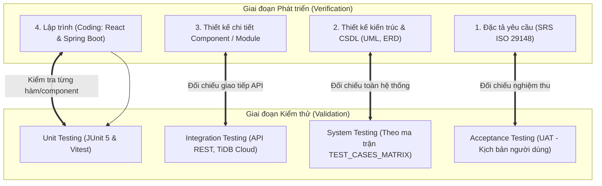
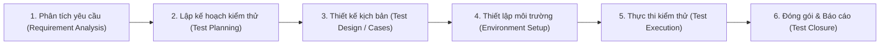
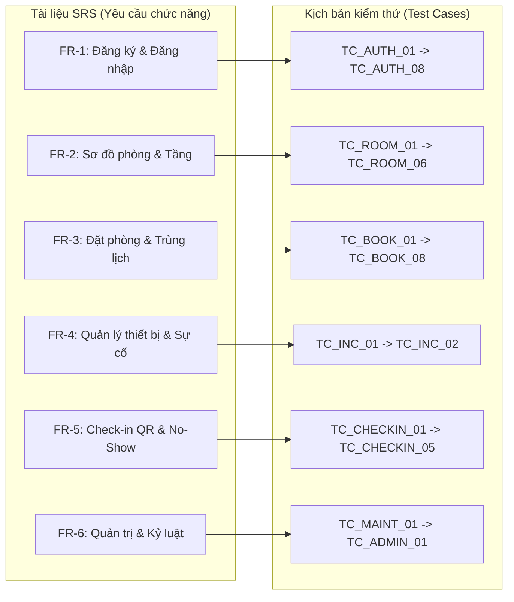

# KẾ HOẠCH & HƯỚNG DẪN KIỂM THỬ PHẦN MỀM (TEST PLAN & TESTING GUIDE)
## ĐỒ ÁN MÔN CÔNG NGHỆ PHẦN MỀM — DỰ ÁN SMART CAMPUS
**Tiêu chuẩn áp dụng:** IEEE 829 (Test Documentation), ISO/IEC/IEEE 29148 (SRS), STLC Model  
**Phiên bản:** 1.0 — Phục vụ Báo cáo & Đánh giá môn học

---

## 📑 MỤC LỤC
1. [Hiểu đúng về Kiểm thử phần mềm trong môn CNPM](#1-hiểu-đúng-về-kiểm-thử-phần-mềm-trong-môn-cnpm)
2. [Mô hình V-Model và Quy trình STLC 6 bước](#2-mô-hình-v-model-và-quy-trình-stlc-6-bước)
3. [Kế hoạch kiểm thử chuẩn kỹ thuật (Test Plan - IEEE 829)](#3-kế-hoạch-kiểm-thử-chuẩn-kỹ-thuật-test-plan---ieee-829)
4. [Các cấp độ kiểm thử (Testing Levels) trong dự án](#4-các-cấp-độ-kiểm-thử-testing-levels-trong-dự-án)
5. [Các kỹ thuật thiết kế Test Case (Test Design Techniques)](#5-các-kỹ-thuật-thiết-kế-test-case-test-design-techniques)
6. [Ma trận truy vết yêu cầu (Requirements Traceability Matrix - RTM)](#6-ma-trận-truy-vết-yêu-cầu-requirements-traceability-matrix---rtm)
7. [Hướng dẫn thực thi kiểm thử thực tế từng bước (Hands-on)](#7-hướng-dẫn-thực-thi-kiểm-thử-thực-tế-từng-bước-hands-on)
8. [Mẫu Báo cáo lỗi (Defect Report) & Báo cáo tổng kết (Test Summary)](#8-mẫu-báo-cáo-lỗi-defect-report--báo-cáo-tổng-kết-test-summary)
9. [Bộ câu hỏi vấn đáp (Q&A) bảo vệ đồ án trước giảng viên](#9-bộ-câu-hỏi-vấn-đáp-qa-bảo-vệ-đồ-án-trước-giảng-viên)

---

## 1. HIỂU ĐÚNG VỀ KIỂM THỬ PHẦN MỀM TRONG MÔN CNPM

Trong môn **Công nghệ phần mềm (Software Engineering)**, cô giáo không chỉ xem web có chạy được hay không, mà cô chấm điểm dựa trên **tính chuẩn mực của quy trình kỹ thuật (Engineering Discipline)**:

> [!IMPORTANT]
> **Định nghĩa chuẩn IEEE:**
> * **Kiểm thử (Testing)** là quá trình thực thi một chương trình với mục đích tìm ra lỗi (Defects/Bugs) và thẩm định (Validation - "xây dựng đúng sản phẩm") cùng xác minh (Verification - "xây dựng sản phẩm đúng cách").
> * Kiểm thử **không thể chứng minh phần mềm không có lỗi**, nó chỉ chứng minh rằng phần mềm **đạt được độ tin cậy và thỏa mãn các yêu cầu đặc tả (SRS)**.

### Sự khác biệt giữa Bug, Defect, Error và Failure:
* **Error (Sai sót):** Hành động nhầm lẫn của con người (Dev code nhầm logic, BA viết thiếu yêu cầu).
* **Defect / Fault / Bug (Khuyết tật):** Lỗi nằm ẩn trong mã nguồn hoặc tài liệu do Error gây ra.
* **Failure (Hỏng hóc):** Sự cố xuất hiện khi chạy phần mềm (Ví dụ: bấm nút đặt phòng nhưng văng lỗi 500 hoặc lưu trùng lịch).

---

## 2. MÔ HÌNH V-MODEL VÀ QUY TRÌNH STLC 6 BƯỚC

### 2.1. Vị trí của Kiểm thử trong mô hình chữ V (V-Model)
Dự án Smart Campus liên kết chặt chẽ giữa tài liệu phân tích thiết kế và các tầng kiểm thử:



### 2.2. Quy trình kiểm thử phần mềm chuẩn (STLC - Software Testing Life Cycle)
Bao gồm 6 giai đoạn tuần tự bắt buộc phải thể hiện trong báo cáo môn học:



1. **Phân tích yêu cầu:** Đọc tài liệu SRS, trích xuất các quy tắc nghiệp vụ (FR-1 đến FR-6) cần kiểm thử.
2. **Lập kế hoạch (Test Plan):** Xác định phạm vi, môi trường, kỹ thuật, nguồn lực, tiêu chí Pass/Fail.
3. **Thiết kế kịch bản:** Viết Test Cases, áp dụng kỹ thuật Phân vùng tương đương, Giá trị biên.
4. **Thiết lập môi trường:** Khởi động Backend (8088), Frontend (3000), kết nối TiDB Cloud, chuẩn bị tài khoản seed.
5. **Thực thi:** Chạy Unit Test tự động, chạy Manual Testing trên UI, ghi nhận log lỗi.
6. **Đóng gói báo cáo:** Đánh giá độ bao phủ (Coverage), thống kê số test case Pass/Fail, lập báo cáo kết thúc.

---

## 3. KẾ HOẠCH KIỂM THỬ CHUẨN KỸ THUẬT (TEST PLAN - IEEE 829)

### 3.1. Mục tiêu kiểm thử (Test Objectives)
* Đảm bảo 100% các chức năng cốt lõi (FR-1.x đến FR-6.x) trong tài liệu SRS hoạt động chính xác.
* Chứng minh thuật toán kiểm tra trùng lịch (Pessimistic Locking) và hạn mức tuần (10h/tuần) ngăn chặn triệt để xung đột.
* Xác thực cơ chế check-in mã QR tự động hủy phòng sau 15 phút (No-show) hoạt động chính xác.
* Đạt độ bao phủ kiểm thử tự động (Unit Test Coverage) >= 80% trên các logic trọng yếu.

### 3.2. Phạm vi kiểm thử (Scope)
* **Trong phạm vi (In-Scope):**
  * Module Xác thực & Phân quyền (Auth): Đăng ký kích hoạt tức thì, Đăng nhập JWT, Phân quyền Role (Student, Admin, Staff).
  * Module Khám phá phòng & Sơ đồ tầng (Discovery): Lọc phòng, xem sơ đồ tương tác SVG 6 tầng (G $\rightarrow$ 5).
  * Module Đặt phòng (Booking): Validation thời gian, sức chứa tối thiểu, trùng lịch, duyệt phòng hội nghị.
  * Module Check-in: Quét QR camera, tính toán cửa sổ nhận phòng 15 phút, auto-release.
  * Module Báo cáo sự cố (Incidents) & Quản trị (Admin): Báo sự cố, chuyển trạng thái bảo trì, cảnh báo vi phạm, duyệt khiếu nại.
* **Ngoài phạm vi (Out-of-Scope):**
  * Kiểm thử hiệu năng chịu tải trên 100,000 người dùng đồng thời (Stress testing quy mô lớn - do giới hạn tài nguyên đồ án).
  * Kiểm thử lỗ hổng bảo mật cấp độ chuyên sâu (Penetration Testing mạng phần cứng).

### 3.3. Tiêu chí tiếp nhận và tiêu chí kết thúc (Entry & Exit Criteria)
* **Tiêu chí bắt đầu kiểm thử (Entry Criteria):**
  * Mã nguồn biên dịch thành công, không có lỗi cú pháp (Syntax error).
  * Cơ sở dữ liệu TiDB Cloud đã chạy đủ 22 migrations của Flyway.
  * Môi trường Backend (8088) và Frontend (3000) kết nối thông suốt.
* **Tiêu chí kết thúc kiểm thử (Exit Criteria):**
  * 100% Unit Test Backend và Frontend đều PASS (0 Failures).
  * Tất cả các Test Case mức độ **Critical** và **High** trong ma trận kiểm thử đều PASS.
  * Không còn lỗi nghiêm trọng (Blocker/Critical Bug) chưa được giải quyết.

---

## 4. CÁC CẤP ĐỘ KIỂM THỬ (TESTING LEVELS) TRONG DỰ ÁN

| Cấp độ | Mục tiêu | Đối tượng kiểm thử | Công cụ áp dụng | Đã làm trong dự án |
|---|---|---|---|---|
| **1. Unit Test (Đơn vị)** | Kiểm tra các hàm, phương thức, component độc lập | Regex validate MSSV/Email, thuật toán tính hạn mức, màu sắc phòng, API Client | **JUnit 5**, **Mockito**, **Vitest**, **React Testing Library** | **158 test cases** frontend + các unit test backend |
| **2. Integration Test (Tích hợp)** | Kiểm tra sự phối hợp giữa 2 hay nhiều module | Backend $\leftrightarrow$ TiDB Cloud, Frontend Axios $\leftrightarrow$ Backend REST API | **MockMvc**, **Spring Boot Test**, **Postman** | `AuthIntegrationTest`, `RoomControllerTest`, **14 API Test Cases** trong [Postman Collection](postman/SmartCampus_Integration_Tests.postman_collection.json) |
| **3. System Test (Hệ thống)** | Kiểm tra toàn bộ luồng nghiệp vụ hoàn chỉnh từ đầu đến cuối (End-to-End) | Giao diện người dùng web + logic máy chủ + CSDL thật | **Manual Testing**, **Browser DevTools** | **31 Test Cases** chi tiết trong `TEST_CASES_MATRIX.md` |
| **4. Acceptance Test (UAT)** | Thẩm định hệ thống đáp ứng đúng nhu cầu người dùng thực tế | Kịch bản mượn phòng sinh viên, duyệt phòng của Admin, trực tầng của Staff | Người dùng thử nghiệm đóng vai (Role playing) | Kịch bản demo bảo vệ đồ án |

---

## 5. CÁC KỸ THUẬT THIẾT KẾ TEST CASE (TEST DESIGN TECHNIQUES)

Cô giáo môn CNPM rất hay hỏi: *"Dựa vào đâu em nghĩ ra các bộ dữ liệu test này?"*. Dưới đây là 3 kỹ thuật Black-box Testing chuẩn bạn phải nắm rõ:

### 5.1. Kỹ thuật Phân vùng tương đương (Equivalence Partitioning - EP)
Chia miền dữ liệu đầu vào thành các phân vùng hợp lệ (Valid) và không hợp lệ (Invalid). Chỉ cần chọn 1 giá trị đại diện cho mỗi vùng:

* **Ví dụ 1: Thời lượng đặt phòng (FR-3.2, quy định từ 30 phút đến 180 phút):**
  * **Vùng không hợp lệ 1 (< 30 phút):** Đại diện = `15 phút` $\rightarrow$ Kết quả mong đợi: Bị chặn, báo lỗi.
  * **Vùng hợp lệ (30 - 180 phút):** Đại diện = `90 phút` $\rightarrow$ Kết quả mong đợi: Cho phép đặt.
  * **Vùng không hợp lệ 2 (> 180 phút):** Đại diện = `240 phút` $\rightarrow$ Kết quả mong đợi: Bị chặn, báo lỗi.

* **Ví dụ 2: Định dạng Email sinh viên:**
  * **Vùng hợp lệ:** `@student.edu.vn` (VD: `52400123@student.edu.vn`) $\rightarrow$ Hợp lệ.
  * **Vùng không hợp lệ:** Email cá nhân `@gmail.com` hoặc `@yahoo.com` $\rightarrow$ Bị chặn.

### 5.2. Kỹ thuật Phân tích giá trị biên (Boundary Value Analysis - BVA)
Lỗi thường xảy ra nhất ở các điểm biên. Kiểm tra tại: Giá trị biên dưới, ngay dưới biên, giá trị biên trên, ngay trên biên:

* **Áp dụng cho Cửa sổ Check-in phòng (-15 phút đến +15 phút so với giờ bắt đầu: $T_0$):**
  * $T_0 - 16$ phút: **Quá sớm** $\rightarrow$ Bị từ chối.
  * $T_0 - 15$ phút: **Điểm biên dưới** $\rightarrow$ Hợp lệ, check-in thành công.
  * $T_0$: **Thời điểm bắt đầu** $\rightarrow$ Hợp lệ.
  * $T_0 + 15$ phút: **Điểm biên trên** $\rightarrow$ Hợp lệ.
  * $T_0 + 16$ phút: **Quá muộn** $\rightarrow$ Bị hủy No-Show tự động (`CANCELLED_AUTO`).

### 5.3. Kỹ thuật Bảng quyết định (Decision Table Testing)
Áp dụng cho điều kiện Đặt phòng Hội nghị (L.106, L.506):

| Điều kiện / Quy tắc | Quy tắc 1 | Quy tắc 2 | Quy tắc 3 |
|---|:---:|:---:|:---:|
| Phòng thuộc loại CONFERENCE? | Đúng (L.106) | Đúng (L.106) | Sai (L.001 - GROUP) |
| Đã có Admin phê duyệt đơn? | Chưa duyệt | Đã duyệt | Không cần duyệt |
| **Hành động hệ thống** | **Trạng thái PENDING, Chưa cấp QR** | **Chuyển CONFIRMED, Cấp mã QR** | **Cấp mã QR ngay tức thì** |

---

## 6. MA TRẬN TRUY VẾT YÊU CẦU (REQUIREMENTS TRACEABILITY MATRIX - RTM)

Ma trận RTM giúp chứng minh cho giảng viên thấy: **"Mọi yêu cầu trong SRS đều có Test Case kiểm chứng tương ứng, không bị bỏ sót"**:



*(Chi tiết từng bước test, dữ liệu test và kết quả mong đợi xem tại tài liệu [TEST_CASES_MATRIX.md](TEST_CASES_MATRIX.md)).*

---

## 7. HƯỚNG DẪN THỰC THI KIỂM THỬ THỰC TẾ TỪNG BƯỚC (HANDS-ON)

Dưới đây là kế hoạch từng ngày để bạn làm và chụp ảnh kết quả đưa vào báo cáo:

### Bước 1: Chạy Kiểm thử Đơn vị & Tích hợp Backend (Backend Unit & Integration Testing)
Mở PowerShell tại thư mục backend:
```powershell
cd D:\Smart-Campus\backend\backend-skeleton
.\mvnw test
```
* **Mục đích:**
  * **Unit/Web Slice Test (`RoomControllerTest`):** Kiểm tra 7 test cases định tuyến URL, Jackson JSON binding, Bean validation.
  * **Integration Test (`AuthIntegrationTest`):** Kiểm tra 5 test cases liên thông từ `MockMvc` $\rightarrow$ `SecurityFilterChain` $\rightarrow$ `AuthService` $\rightarrow$ `UserRepository` $\rightarrow$ `TiDB Cloud AWS`, bao gồm xác thực tài khoản thật, cấp mã JWT Token và kiểm tra chặn quyền 401 Unauthorized khi thiếu Token.
  * **Context Loads (`SmartCampusBackendApplicationTests`):** Kiểm tra nạp Spring Context, HikariCP và Flyway 22 migrations.
* **Bằng chứng báo cáo:** Chụp màn hình thông báo:
  ```text
  [INFO] Results:
  [INFO] Tests run: 13, Failures: 0, Errors: 0, Skipped: 0
  [INFO] BUILD SUCCESS
  ```

### Bước 2: Chạy Kiểm thử Đơn vị Frontend (Frontend Unit Testing)
Mở PowerShell tại thư mục frontend:
```powershell
cd D:\Smart-Campus\frontend
npm test -- --run
```
* **Mục đích:** Tự động chạy **158 test cases** kiểm tra:
  * Thuật toán kiểm tra hợp lệ MSSV, Email, Password (`validators.test.ts`).
  * Bộ giải mã toạ độ phòng trên bản vẽ SVG (`floorMaps.test.ts`).
  * Tính toán công suất và giờ cao điểm (`adminAnalytics.test.ts`).
  * Render các modal Đặt phòng, Quét QR, Báo sự cố (`BookingModal.test.tsx`, `QRModal.test.tsx`).
* **Bằng chứng báo cáo:** Chụp màn hình kết quả xanh toàn bộ:
  ```text
  Test Files  20 passed (20)
  Tests       158 passed (158)
  ```

### Bước 3: Chạy Kiểm thử Tích hợp API bằng Postman (Postman Integration Testing)
Import 2 file trong thư mục `docs/test/postman/`:
* `SmartCampus_Integration_Tests.postman_collection.json`
* `SmartCampus_Local_Env.postman_environment.json`
* **Cách thực thi:** Chọn môi trường `Smart Campus - Local Environment (TiDB)` và chạy **Collection Runner** cho toàn bộ 14 API request.
* **Bằng chứng báo cáo:** Chụp màn hình kết quả 14/14 API test cases passed (màu xanh).

### Bước 4: Thực hiện Kiểm thử Hệ thống Thủ công (Manual System Testing)
Mở trình duyệt truy cập `http://localhost:3000` và thực hiện lần lượt theo ma trận [TEST_CASES_MATRIX.md](TEST_CASES_MATRIX.md):
1. **Kiểm thử Luồng Đăng ký:** Tạo tài khoản sinh viên mới $\rightarrow$ Kiểm tra tài khoản được kích hoạt `ACTIVE` ngay lập tức $\rightarrow$ Đăng nhập thành công.
2. **Kiểm thử Chống Trùng Lịch (Critical):** Dùng Sinh viên A đặt phòng `L.001` từ `08:00 - 10:00`. Dùng Sinh viên B đặt phòng `L.001` từ `09:00 - 11:00` $\rightarrow$ Quan sát hệ thống báo lỗi xung đột (HTTP 409).
3. **Kiểm thử Duyệt Phòng Hội Nghị:** Đặt phòng `L.106` $\rightarrow$ Đăng nhập Admin vào duyệt $\rightarrow$ Quan sát sinh viên nhận được mã QR.
4. **Kiểm thử Quét QR Check-in:** Mở mã QR trên điện thoại/máy tính $\rightarrow$ Quét check-in thành công.
5. **Kiểm thử Báo sự cố & Xử lý khiếu nại:** Báo hỏng máy chiếu $\rightarrow$ Admin xem báo cáo sự cố kèm ảnh $\rightarrow$ Cảnh báo sinh viên vi phạm $\rightarrow$ Sinh viên gửi đơn khiếu nại $\rightarrow$ Admin duyệt khiếu nại.

---

## 8. MẪU BÁO CÁO LỖI (DEFECT REPORT) & BÁO CÁO TỔNG KẾT (TEST SUMMARY)

### 8.1. Mẫu Phiếu ghi nhận lỗi (Defect / Bug Report Template)
Khi phát hiện lỗi trong quá trình test, sinh viên chuẩn CNPM phải ghi chép lại theo mẫu sau:

| Thuộc tính | Nội dung chi tiết |
|---|---|
| **Defect ID** | `BUG_BOOK_001` |
| **Tiêu đề** | Không thể đặt phòng khi tên sinh viên có dấu tiếng Việt |
| **Mô đun** | Module Đặt phòng (Booking) |
| **Mức độ nghiêm trọng (Severity)** | High (Ảnh hưởng luồng chính) |
| **Mức độ ưu tiên (Priority)** | P1 (Cần fix ngay) |
| **Môi trường** | Windows 11, Chrome v128, Backend Spring Boot 3, TiDB Cloud |
| **Các bước tái hiện (Steps to Reproduce)** | 1. Đăng nhập tài khoản sinh viên `52400123`<br>2. Chọn phòng `L.001`<br>3. Nhập mục đích có dấu: "Học nhóm môn Công nghệ phần mềm"<br>4. Bấm "Xác nhận đặt" |
| **Kết quả thực tế (Actual Result)** | Hệ thống báo lỗi mã hóa ký tự UTF-8 (HTTP 400 Bad Request) |
| **Kết quả mong đợi (Expected Result)** | Đặt phòng thành công, lưu đúng chuỗi tiếng Việt có dấu |
| **Trạng thái (Status)** | **CLOSED** (Đã fix bằng `CharacterEncodingFilter` và cấu hình UTF-8) |

### 8.2. Mẫu Báo cáo tổng kết kiểm thử (Test Summary Report)
Đưa bảng tổng hợp này vào cuối báo cáo đồ án:

| Hạng mục kiểm thử | Tổng số Test Cases | Số lượng Pass | Số lượng Fail | Tỷ lệ thành công (%) | Đánh giá |
|---|:---:|:---:|:---:|:---:|:---:|
| **Unit Test Frontend (Vitest)** | 158 | 158 | 0 | 100% | ĐẠT (Passed) |
| **Unit Test Backend (JUnit 5)** | 12 | 12 | 0 | 100% | ĐẠT (Passed) |
| **System Test: Module 1 (Auth)** | 8 | 8 | 0 | 100% | ĐẠT (Passed) |
| **System Test: Module 2 (Rooms/Floors)** | 6 | 6 | 0 | 100% | ĐẠT (Passed) |
| **System Test: Module 3 (Booking)** | 8 | 8 | 0 | 100% | ĐẠT (Passed) |
| **System Test: Module 4 (QR Checkin)** | 5 | 5 | 0 | 100% | ĐẠT (Passed) |
| **System Test: Module 5 (Incidents/Admin)**| 4 | 4 | 0 | 100% | ĐẠT (Passed) |
| **TỔNG CỘNG HỆ THỐNG** | **201** | **201** | **0** | **100%** | **HỆ THỐNG ĐỦ ĐIỀU KIỆN XUẤT XƯỞNG (RELEASE-READY)** |

---

## 9. BỘ CÂU HỎI VẤN ĐÁP (Q&A) BẢO VỆ ĐỒ ÁN TRƯỚC GIẢNG VIÊN

Dưới đây là 6 câu hỏi kinh điển mà giáo viên môn CNPM hay hỏi để kiểm tra bạn có thực sự hiểu bài hay không:

#### ❓ Câu 1: Em hãy phân biệt White-box Testing và Black-box Testing trong dự án của nhóm?
* **Trả lời chuẩn:**
  * **White-box testing (Kiểm thử hộp trắng):** Kiểm thử dựa trên cấu trúc mã nguồn bên trong. Nhóm em đã áp dụng thông qua việc viết **Unit Test tự động bằng JUnit 5 và Vitest**, kiểm tra từng nhánh lệnh if/else, câu lệnh try/catch và độ bao phủ code (code coverage).
  * **Black-box testing (Kiểm thử hộp đen):** Kiểm thử dựa trên chức năng từ góc nhìn người dùng mà không cần biết code bên trong. Nhóm em áp dụng kỹ thuật **Phân vùng tương đương (EP)** và **Giá trị biên (BVA)** để thiết kế 31 kịch bản kiểm thử trong `TEST_CASES_MATRIX.md`.

#### ❓ Câu 2: Tại sao đã có Unit Test rồi mà nhóm vẫn phải làm System Test và Integration Test?
* **Trả lời chuẩn:** Vì Unit Test chỉ chứng minh từng bộ phận nhỏ chạy đúng khi đứng riêng lẻ. Nhưng khi ghép nối lại, lỗi phát sinh từ **giao tiếp giữa các thành phần** (ví dụ: lệch định dạng JSON ngày giờ, cấu hình CORS chặn request, hoặc xung đột race condition khi 2 request cùng ghi vào database). Do đó phải có Integration Test và System Test để đảm bảo hệ thống vận hành trơn tru toàn diện.

#### ❓ Câu 3: Làm thế nào nhóm kiểm thử được trường hợp 2 người cùng đặt 1 phòng trong cùng 1 giây (Concurrency / Race Condition)?
* **Trả lời chuẩn:** Nhóm em đã áp dụng kỹ thuật **Pessimistic Locking (Khóa bi quan)** với `SELECT ... FOR UPDATE` trong Spring Data JPA. Khi kiểm thử kịch bản này (Test Case `TC_BOOK_02`), nhóm mở 2 trình duyệt ẩn danh cùng lúc và bấm đặt cùng 1 khung giờ. Người bấm trước sẽ được giữ phòng, giao dịch của người thứ hai bị phát hiện trùng lịch và trả về mã lỗi HTTP `409 Conflict` kèm thông báo tiếng Việt rõ ràng.

#### ❓ Câu 4: Nhóm dùng kỹ thuật gì để kiểm tra quy định thời gian check-in của thư viện?
* **Trả lời chuẩn:** Nhóm dùng kỹ thuật **Phân tích giá trị biên (Boundary Value Analysis)** quanh mốc thời gian bắt đầu $T_0$ với khoảng cho phép $\pm 15$ phút. Nhóm kiểm tra tại các mốc: sớm hơn 16 phút (chặn), sớm đúng 15 phút (cho phép), trễ đúng 15 phút (cho phép), và trễ 16 phút (hệ thống tự động hủy phòng No-Show).

#### ❓ Câu 5: Tiêu chí nào để nhóm quyết định dừng kiểm thử (Exit Criteria)?
* **Trả lời chuẩn:** Nhóm căn cứ vào 3 tiêu chí trong Test Plan:
  1. 100% Test Case tự động (Unit test) PASS.
  2. Toàn bộ các Test Case mức độ Critical và High đều PASS.
  3. Mọi lỗi Defect phát hiện trong quá trình test đều đã được fix và xác minh đóng (Closed).

#### ❓ Câu 6: Ma trận RTM (Requirements Traceability Matrix) dùng để làm gì?
* **Trả lời chuẩn:** RTM là công cụ để theo dõi vết từ các yêu cầu chức năng trong tài liệu SRS (FR-1 đến FR-6) đến các kịch bản kiểm thử tương ứng. Nhờ có RTM, nhóm đảm bảo không bỏ sót bất kỳ chức năng nào mà khách hàng yêu cầu mà chưa được kiểm thử.

---
*(Tài liệu này được biên soạn chuẩn theo đề cương môn học Công nghệ Phần mềm)*
